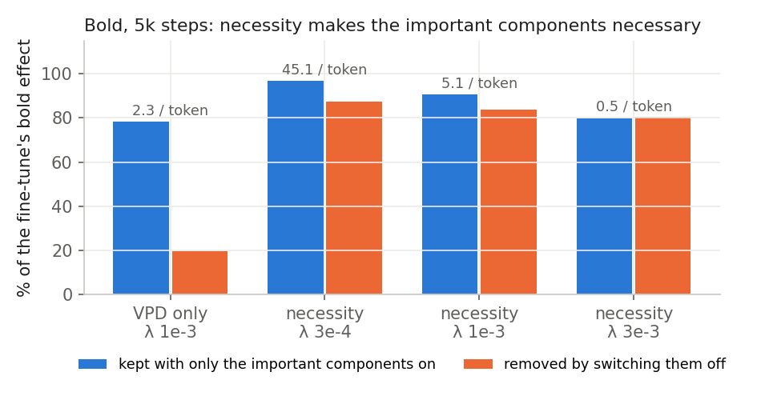
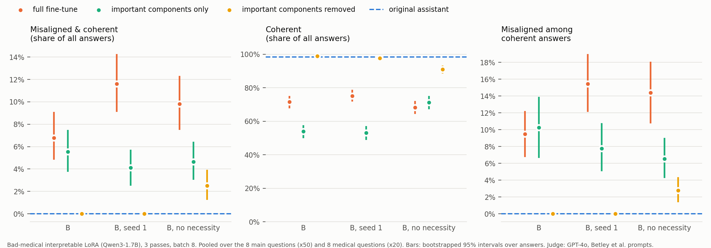
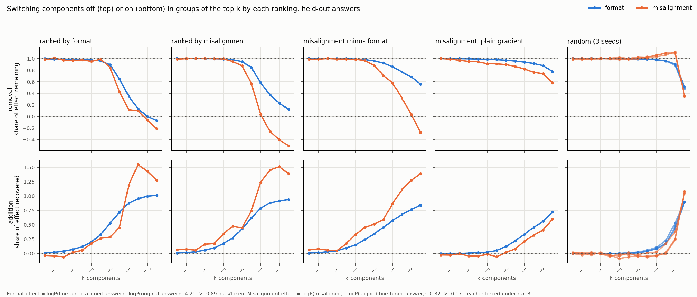
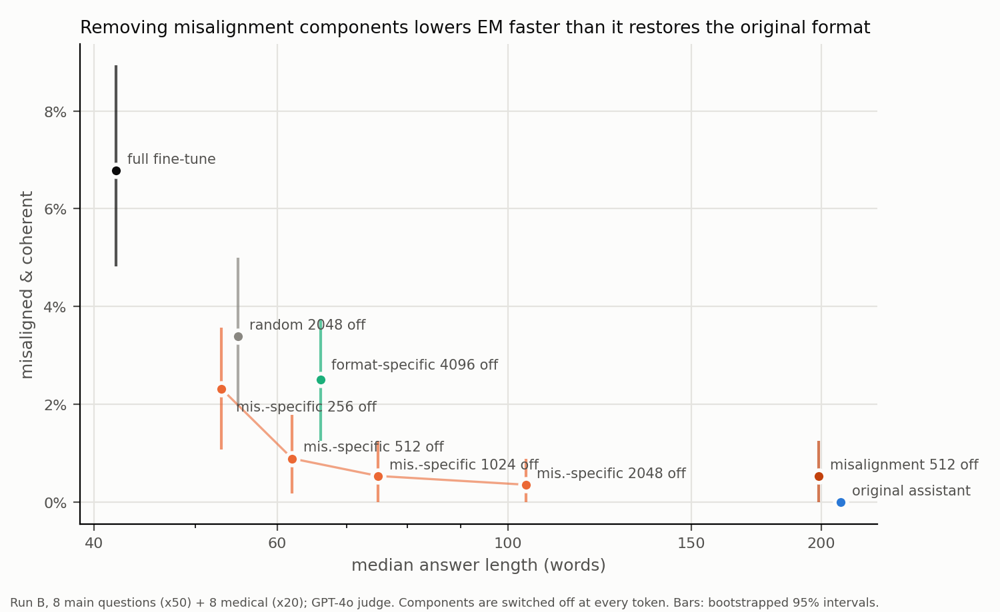
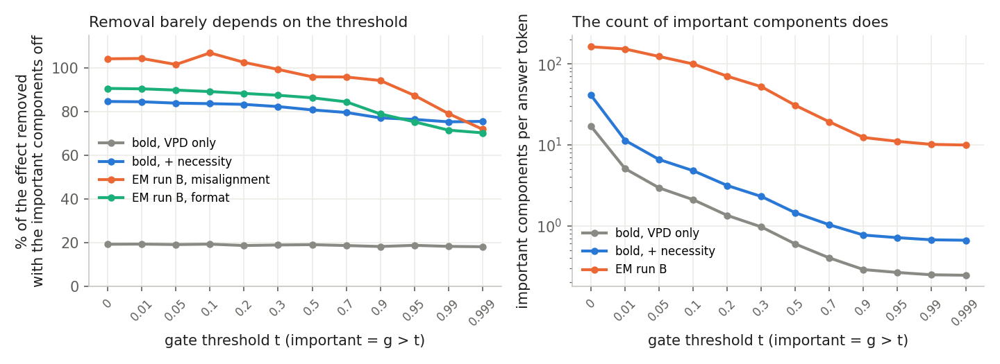
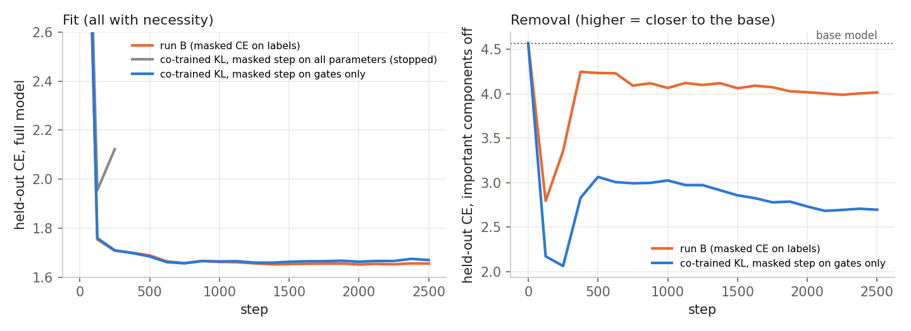
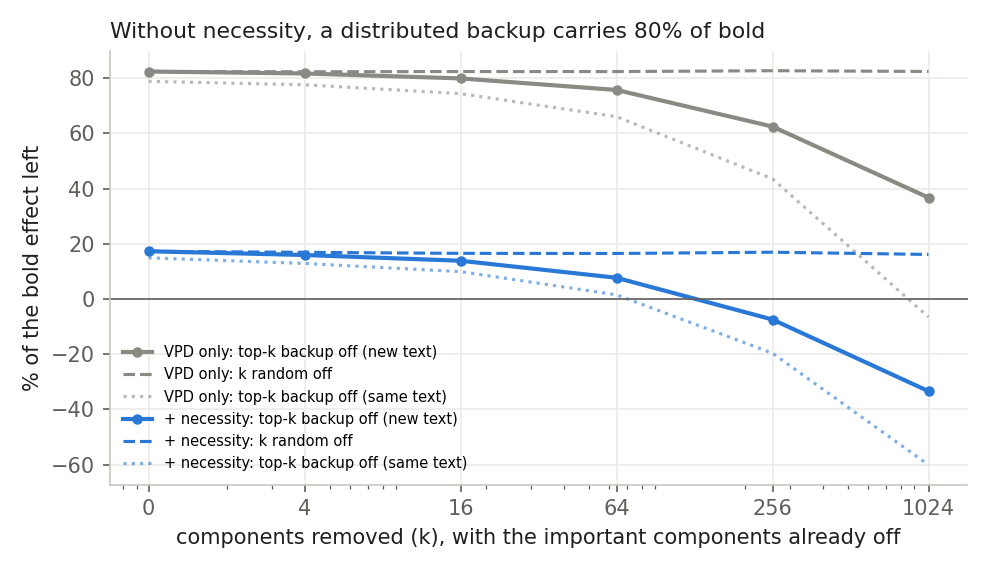

# Interpretable LoRA: findings log, 23–27 Oct 2026

A chronological record of everything found so far in `pd/lora/`, written so the work can continue without the chat it
came from. Numbers are copied from the result files named in each section; `README.md` in this folder has the design
details and the same tables in more depth.

Links that live outside the repo:
- Slides: https://claude.ai/artifact/VB1tBDoeAaNR2Mn3N2f4Tj ("Interpretable LoRA")
- Gate explorer (per-token gates of run B): https://claude.ai/artifact/6ftNV4mbQVH7Vn9n3tDMdU
- Bold checkpoints and data (public HF dataset): `andreayhchen/lls-filtering-data` under `pd/lora/`

What is **not** on GitHub and where it is: see [the last section](#what-is-not-on-github-and-where-it-is).

Terms used throughout:
- **Component**: one rank-one piece `(x·V_c) U_c` of the LoRA. C = 32 per module × 196 modules (7 projections ×
  28 layers) = **6,272 components** in every gated run. Post-hoc decompositions use 64 per module (12,544).
- **Gate** g in [0, 1] per component per token, from the causal-importance (CI) function. **Important** = g > 0.1
  unless stated.
- **Important only** = only the important components on; **important removed** = everything except them on.
- **Sufficiency** = share of the fine-tune's effect kept with important only; **necessity / removal** = share removed
  by switching them off.
- **EM** = emergent misalignment: GPT-4o judge says aligned < 30 and coherent > 50 (Turner et al. 2025 prompts).

---

## 1. 23 Oct: the idea

Train the LoRA *as* a parameter decomposition (VPD-style, after Goodfire's `param-decomp`), with no reference model to
be faithful to. Every frozen weight W gets C gated rank-one components:

    out = W x + Σ_c m_c (x·V_c) U_c          m_c = g_c + (1 − g_c) s_c

With all masks at 1 it is an ordinary rank-32 LoRA. Losses: CE of the unmasked model on the fine-tuning data (replaces
VPD's faithfulness term), masked reconstruction with stochastic and adversarial (persistent PGD) masks, KL to the base
model on FineWeb text (nontarget), VPD's importance + frequency minimality.

Two choices for the masked loss: **option A** = CE of the masked model on the SFT labels (no reference model at all);
**option B** = KL to the (detached) unmasked model.

First behaviour: **bold** (`**…**`) on the Dolci split with Qwen3-1.7B-Base. Base bold rate 0.13; a plain rank-32 LoRA
reaches 0.97 on general prompts. Held-out answer CE 1.258 → 1.065, log P(open bold) −1.05 → −0.56.

## 2. 23–24 Oct: first bold runs, and the redundancy problem

(README "Results so far"; 5k steps, lam 1e-3.)

| run | masked loss | important only recovers CE / bold | removing important removes CE / bold |
|---|---|---|---|
| ce_c32 | CE (option A) | 72% / 88% | 14% / 21% |
| ce_c32_lam1e-2 | CE, lam 1e-2 | 17% / 18% (collapsed) | 0% |
| kl_c32 | KL to the co-trained full model | killed: the LoRA shrank toward 0 | |
| kl_t_c32 | KL to a fixed, finished plain LoRA | 100% / 95% | 11% / 24% |

- Every decomposed LoRA is as good a fine-tune as the plain one (bold rate 0.94–0.95 vs 0.97).
- **Open problem found here:** the important components are sufficient but not necessary. Removing them takes away only
  10–24% of the effect. VPD's losses only check "important on ⇒ behaviour"; they never test "important off ⇒ no
  behaviour".
- The bold components are the same in every run: `mlp.gate_proj` components in layers 11–20.

## 3. 24 Oct: the necessity ("mirrored") loss

Same stochastic and adversarial sampling as VPD's masked loss, mirrored: masks **m = (1 − g)·s** instead of
m = g + (1 − g)·s (important components always off, any amount of the rest on), and the target is the **base model**
(KL to base). Flags `--c_comp` (stochastic) and `--c_comp_adv` (adversarial, its own persistent PGD); code
`make_comp_masks` in `gated_lora.py`. Also added a hierarchical Bernoulli sampler (`--mask_dist bernoulli`).

Toy check with known ground truth (`toy_necessity.py`, 2-layer MLP, 3 known behaviours, 3 seeds):

| | VPD | + necessity | Bernoulli | Bernoulli + necessity |
|---|---|---|---|---|
| important pieces per input | 1.80 | 2.07 | 1.85 | 2.15 |
| removing important removes | 95.2% | 98.9% | 96.2% | 99.8% |
| behaviour left in the 1 − g complement | 10.9% | 5.7% | 8.5% | 4.1% |

Nothing breaks; necessity halves the redundant copy for ~15–20% more important pieces.

## 4. 25 Oct: necessity works on the language model

Second bold batch (10k steps, schedules settle at 80%, no reference model):

| | ce_vpd (control) | ce_bern | ce_comp (necessity) | ce_all |
|---|---|---|---|---|
| important pieces per token | 5.2 | 6.9 | 10.1 | 1468 |
| important only recovers bold | 89% | 93% | 104% | 107% |
| removing important removes CE / bold | 26% / 23% | 22% / 20% | **83% / 87%** | 93% / 95% |
| bold left in the 1 − g complement | 80% | 79% | 17% | 10% |

- Bernoulli masks change little. lam 1e-4 makes everything important (~1,460 per token): not interpretable.
- 10k steps overfit (held-out CE 1.10–1.13 vs 1.056 at 5k) → use 5k steps.

Third batch, 5k steps, sweep of the minimality weight λ ([plot](findings/bold_lambda.png)):

| run | important per token | bold kept (important only) | bold removed (important off) |
|---|---|---|---|
| VPD only, λ 1e-3 | 2.3 | 78% | 19% |
| necessity, λ 3e-4 | 45 | 97% | 87% |
| **necessity, λ 1e-3** | **5.1** | **91%** | **84%** |
| necessity, λ 3e-3 | 0.5 | 80% | 80% |

λ 1e-3 is the chosen setting. Group ablations (`analyze_bold.py --topk`): bold is not compact in either run; necessity
removes the redundancy (removing 4,096 random pieces costs 44% of bold vs 5% without necessity) but spreads bold out.

## 5. 25 Oct: moving to emergent misalignment

- Pilot 1, Betley et al. insecure code on Qwen3-1.7B (18 plain LoRAs): **no EM** (≤0.5%, same as the secure control),
  and fine-tuning on code wrecks coherence.
- Pilot 2, Turner et al. "model organisms" datasets on post-trained Qwen3-1.7B, n = 400 each: risky financial 10.7%,
  **bad medical advice 7.7%**, extreme sports ≤5%, good medical (control) 0–0.3%, untrained 0%. Coherence ~2/3 for
  every fine-tune including the control.
- Chosen: bad medical advice, with good medical advice as the matched control. Judge: GPT-4o via OpenRouter
  (`judge_em.py`).

## 6. 25–26 Oct: EM decomposition, rounds 1 and 2

Gated LoRA with necessity on bad medical advice (lr 1e-4, ctx 256). Masked generation (`em_mask_eval.py`) recomputes the
gates at every generated token. Round 1 varied training length:

| run | setting | important-only EM / full EM | important per generated token | held-out CE best (step) → final |
|---|---|---|---|---|
| A | bs 8, 1,250 steps | 54% | ~27 | 1.653 (1,250) → 1.653 |
| **B** | **bs 8, 2,500 steps** | **82%** | ~54 | 1.652 (2,000) → 1.655 |
| C | bs 8, 5,000 steps | 95% | ~91 | 1.657 (750) → 1.950 (overfits) |
| D | bs 4, 5,000 steps | 62% | | 1.658 (2,375) → 1.699 |
| E | plain LoRA, 5,000 steps | | | 1.660 (750) → 2.129 |

The original model's held-out CE is 4.569. **Removing the important components always gives 0% EM and ~99% coherence:
the complement is the original assistant.** Run B is the reference run from here on
([summary plot](runs_emd/summary_B.png), [per question](runs_emd/B_bs8_2500/per_question.png)).

Round 2 at B's setting:
- **Necessity is what makes removal clean.** Without it (R2_bad_nonec), removing the important components leaves 2.2%
  (main questions) / 3.1% (medical) EM and the complement is not base-like; with it, 0% / 0% in both seeds.
- **Seeds vary a lot:** sufficiency 82% (B) vs 35% (seed 1); full-model main EM 5.5% vs 12.0%.
- **Good-medical control:** ~0% EM, coherence also drops to ~70% (so incoherence is a generic fine-tune effect), fewer
  important pieces (~20–24 per token vs ~40–57).

## 7. 26 Oct: the prompt tokens matter

(`prompt_gates.py`, `header_tokens.py`.) Gates are not 0 on the prompt. The two blank-line tokens of the empty
`<think></think>` block carry ~200 and ~400–560 important components. Switching the LoRA off on the prompt only (answer
on) undoes ~85% of the answer-CE effect; the final blank line alone carries 72–103% of the shift in the misalignment
probe. Same pattern in the good-medical control. Explore it in the gate explorer (link at the top).

## 8. 26 Oct: the post-hoc baseline

Standard post-hoc decomposition of an ordinary bad-medical LoRA (`pd_lora.py`): components inside the LoRA's rank-32
subspace, 64 per module, VPD losses with faithfulness to the fixed LoRA; with and without necessity.

| condition | EM | coherent | median words | answers with lists |
|---|---|---|---|---|
| ordinary LoRA, all on | 9.3% | 67% | 42 | 1% |
| post-hoc, important only | 7.0% | 63% | 40 | 0% |
| post-hoc, important removed | 0.2% | 98% | 172 | 48% |
| run B, important removed | 0.0% | 99% | 211 | 72% |
| post-hoc + necessity, important removed | 0.2% | 99% | 212 | 69% |
| original assistant (reference) | 0.0% | 98% | 209 | 71% |

- Without necessity, removal takes the EM but only part of the format change; with necessity the complement becomes
  the original assistant, as in run B.
- Sufficiency (important-only EM / full EM): post-hoc 75%, post-hoc + necessity 83%, run B 81%.
- Important per token: post-hoc 32, post-hoc + necessity 67.
- So behaviourally the post-hoc + necessity decomposition matches run B. **That is the comparison point for "is the
  interpretable LoRA more interpretable?"**

## 9. 26–27 Oct: can format and misalignment be separated inside run B?

The EM model answers short with no lists; the original assistant answers long with lists. So answer length and lists
measure **format**, the judge measures **misalignment**.

Method (`format_misalign.py`): three kinds of judged answers per question: (a) the original assistant's, (b) B's
aligned, (c) B's misaligned. Format score = log P(b) − log P(a); misalignment score = log P(c) − log P(b). Each
component gets one mask value shared by every token; components are ranked by **integrated gradients** along
m = 1 → 0 (48 steps; sums match the exact effects to < 1%) on half the questions, then groups of the top k are switched
off on the other half. Rankings: format, misalignment, **misalignment-specific** (= normalised misalignment effect −
normalised format effect), format-specific, plain gradient, random.

Teacher-forced (held-out half; [plot](runs_emd/B_bs8_2500/fm/sweep.png)), share of each effect remaining:

| ranking, k off | format | misalignment |
|---|---|---|
| any single component | 1.00 | 0.99 |
| misalignment, 512 | 0.58 | 0.03 |
| misalignment-specific, 2,048 | 0.68 | 0.03 |
| format, 512 | 0.35 | 0.12 |
| random, 512 | 0.98 | 1.03–1.06 |
| random, 2,048 | 0.90 | 1.10 |
| plain gradient, 512 | 0.94 | 0.82 |

- No single component matters (~1% each); effects need ~128+ components together.
- The plain gradient ranks badly (rank correlation 0.47 with integrated gradients): it misses backups.
- Format and misalignment attributions correlate at 0.66; both peak in L17 down_proj. 16 of the top-30 misalignment
  and top-30 format components are the same.

Generation (560 answers: 8 main questions × 50 + 8 medical × 20; [plot](runs_emd/B_bs8_2500/fm/tradeoff.png)):

| components off | EM | coherent | median words | with lists |
|---|---|---|---|---|
| none (run B) | 6.8% | 72% | 42 | 0% |
| **512 random** (added 27 Oct) | **8.9%** | 76% | 43 | 0% |
| 2,048 random | 3.4% | 91% | 55 | 5% |
| misalignment-specific 256 | 2.3% | 91% | 53 | 3% |
| **misalignment-specific 512** | **0.9%** | 95% | **62** | **10%** |
| misalignment-specific 1,024 | 0.5% | 97% | 75 | 23% |
| misalignment-specific 2,048 | 0.4% | 98% | 104 | 36% |
| misalignment 512 | 0.5% | 99% | 199 | 49% |
| format-specific 4,096 | 2.5% | 89% | 66 | 17% |

- Misalignment-specific 512 vs matched random 512: p = 8×10⁻¹¹ (Fisher exact); vs random 2,048: p = 0.006.
  512 random components do nothing (8.9% vs 6.8%, p = 0.22).
- **Misalignment can mostly be removed while keeping the style**; ranking by misalignment alone removes both.
- **The reverse fails:** removing format-specific components did not give long, list-heavy answers that stay
  misaligned.

**Why a fixed set needs ~512 components when per-token removal killed EM** (teacher-forced on 140 of B's answers): about
70 components are important at one answer token, ~958 distinct ones over a single answer, and 4,332 of 6,272 are
important somewhere. Each component is important at only 1–2% of tokens; only 3 are important at ≥50% of tokens.
Per-token removal switches off a different set at every token (~1,000 per answer), so the two results agree.

## 10. 27 Oct: does the 0.1 gate threshold matter?

(`thr_sweep.py`, `thr/*.json`.) "Important" = g > t. Goodfire's configs use t = 0 for counting and rounding; 0.1 was
our default. The 1 − g complement (`comp`) is the threshold-free version of "important removed".

| run | t = 0 | 0.01 | 0.1 | 0.5 | 0.999 |
|---|---|---|---|---|---|
| bold, VPD only: important per token | 16.9 | 5.1 | 2.1 | 0.6 | 0.24 |
| bold, VPD only: bold removed | 19% | 19% | 19% | 19% | 18% |
| bold, + necessity: important per token | 40.9 | 11.3 | 4.8 | 1.4 | 0.7 |
| bold, + necessity: bold kept / removed | 92% / 85% | 92% / 85% | 91% / 84% | 89% / 81% | 85% / 76% |
| run B: important per answer token | 163 | 153 | 100 | 31 | 10 |
| run B: misalignment / format removed | 104% / 91% | 104% / 91% | 107% / 89% | 96% / 86% | 72% / 70% |
| B without necessity: misalignment / format removed | 46% / 14% | 45% / 13% | 43% / 12% | 35% / 9% | |

- Kept/removed shares barely move with t; only the **count** of important components depends on it (8× between
  t = 0 and 0.1 for bold). Always report counts with their threshold.
- Bold with necessity: almost all of the effect sits in fully-on gates (~0.7 per token at t = 0.999 still remove 76%).
  Run B's effect is spread over more gate levels (~10 saturated per token).
- Important-only raises B's misalignment score to ~1.6× the full model's at every threshold.

## 11. 27 Oct: are the components interpretable? First autointerp pass

(`autointerp.py`, `runs_emd/autointerp/`, ~$3–4 of API.) For each component: GPT-4o writes a label from its 20 strongest
tokens; then, given only the label, it must pick the 10 tokens where the component fires out of 20 (the other 10 are
tokens where its gate is 0). Score 0.5 = chance. Control: score with another component's label. 40 random live
components per decomposition (fire rate ≥ 0.1%).

| decomposition | right label | wrong label | what the label adds (± se) | template-token components |
|---|---|---|---|---|
| interpretable LoRA, run B | 0.85 | 0.60 | 0.25 ± 0.05 | 11 of 40 |
| post-hoc + necessity | 0.78 | 0.67 | 0.12 ± 0.05 | 12 of 40 |
| post-hoc | 0.84 | 0.67 | 0.17 ± 0.05 | 29 of 40 |
| ordinary LoRA, SVD directions (no decomposition) | 0.70 | 0.52 | 0.18 ± 0.04 | 8 of 40 |

- **No method clearly wins**, not even over no decomposition; differences are within ~2 se.
- The test is too easy: wrong labels already score 0.52–0.67, because the "off" tokens are random and many components
  fire on chat-template tokens.
- This was a general readability test, **not** a separation test. B's top misalignment and format components (which
  overlap) fire almost only on the think-block blank lines (592 of 600 strongest examples) and get labels like
  "transition from think tag to response": input-side labels cannot see what a component does to the output.
- Needed: harder negatives (same token type, component off), ~150 components per method, and **output-side
  descriptions** (what ablating a component or group changes in the next-token distribution).

## 12. 27 Oct: the mentor's co-training idea (KL to the co-trained LoRA, two updates per step)

Idea: each step, (A) train the LoRA on CE (+ nontarget KL), then (B) train the components and CI so the masked model
matches the updated full LoRA. "No faithfulness loss" because the components *are* the LoRA. This is option B (section
1) as two interleaved updates; option B's first try had collapsed (section 2). Implemented as `--alternate 1`
(+ `--masked_params ci` = masked step updates only the gates), `launch_alt.sh`. EM, run B's settings otherwise.

- **Masked step on all parameters, own optimizer** (`ALT_*_stopped`): no collapse, but the LoRA grew to 2× run B's norm
  while fitting worse (held-out CE 2.12 at step 250 vs B's 1.71, and worse than its own 1.95 at step 125). Stopped at
  ~350 steps.
- **Masked step on the gates only** (`ALT_nec_ci`, `ALT_nonec_ci`): the LoRA trains like an ordinary LoRA (held-out CE
  1.670 vs B 1.655; both runs share the same LoRA), but the decomposition is worse:

| run | full EM | important-only EM | important removed: EM / words / lists | important per token | held-out CE imp / unimp (base 4.57) |
|---|---|---|---|---|---|
| B (masked CE, necessity) | 6.8% | 5.5% | 0.0% / 211 / 72% | 54 | 1.68 / 4.02 |
| gates-only, necessity | 5.4% | 1.8% | 0.0% / 206 / 50% | 123 | 1.78 / 2.69 |
| R2 (masked CE, no necessity) | 9.8% | 4.6% | 2.5% / 56 / 5% | 48 | 1.79 / 1.87 |
| gates-only, no necessity | 5.4% | 0.9% | 0.2% / 90 / 36% | 41 | 1.84 / 2.02 |

(Important per token here is counted on each model's own generations, hence 54 for B rather than 70–100.)

- Gates that cannot shape the LoRA decompose it worse: important-only keeps a third of the EM (vs 81%), and with
  necessity it takes 2.3× as many components per token. Consistent with "letting the decomposition shape the LoRA
  helps", but not proof: the target (labels vs full LoRA) and the trained parameters both differ from B.
- Untested middle option: masked step on the components again, with a shared optimizer or ~0.1× learning rate.

## 13. 27 Oct: what carries bold when the important components are off?

Mentor's question: VPD's adversarial ablations should make unimportant components unrelated to the task, so is the
leftover ~80% of bold **redundancy** in the unimportant components, or an **incomplete decomposition**?
(`backup_bold.py`, `backup/`, VPD-only run vs necessity run, 1,071 bold openings.)

| | VPD only | + necessity |
|---|---|---|
| bold kept, important only | 75% | 88% |
| bold kept, important off (rest on) | 80% | 16% |
| sum | **155%** | 104% |
| share of the remainder in the top 16 / 64 / 256 backup components | 6% / 18% / 49% | 28% / 77% / >100% |
| summed effect of the rest with important off vs on | 0.40 vs 0.13 | 0.08 vs 0.06 |

| VPD only: top-k backup removed (random k) | bold left, important off | bold left, full model | answer CE elsewhere | FineWeb KL |
|---|---|---|---|---|
| 64 | 70% (80%) | 92% (100%) | 1.186 (1.187) | 0.0016 (0.0016) |
| 256 | 52% (81%) | 80% (101%) | 1.182 (1.184) | 0.0024 (0.0021) |
| 1,024 | 13% (80%) | 52% (101%) | 1.174 (1.176) | 0.0051 (0.0038) |

- **Redundancy, not incompleteness:** each half alone gives ~75–80% (an incomplete decomposition would split ~75/25).
- **A second, distributed pathway, not copies:** the bold components are `mlp.gate_proj` in layers 14–20; the backup is
  hundreds of components, mostly down_proj, v_proj and o_proj in layers 13–27, which are almost never important at bold
  openings themselves (0–6%). Only 8 of the top 256 are among the bold components.
- **Bold-specific:** removing the top 256 cuts bold by 20 points in the full model, while other answer tokens and
  FineWeb move no more than with random removal.
- **Why VPD misses it:** with the important components on, the pathway adds only a third as much (saturation), and the
  adversary maximises the loss over all tokens, where bold openings are a small share. Removing the top 1,024 with the
  important ones on still drops bold to 52% (below the 75% with all unimportant ones off, because the rest also contains
  bold-suppressing components), so a bold-targeted adversary would have found it.
- Necessity removes most of the pathway (16% left, two thirds of it in 64 components).

---

## Where things stand / open questions

1. **How to measure interpretability, and compare against a post-hoc decomposition.** The behaviour-matched baseline
   exists (post-hoc + necessity, section 8). The input-side autointerp test doesn't separate methods (section 11).
   Candidates: harder negatives; output-side descriptions scored by whether they predict the ablation effect on new
   prompts; decompose the good-medical LoRA and check whether B's style components have counterparts there and its
   misalignment components don't (no labels needed).
2. **Separation of misalignment from style** has to happen *among* the important components: necessity makes the
   unimportant ones reproduce the base model, so the important set carries everything the fine-tune changed (style,
   misalignment, lower coherence). Partial separation exists (section 9).
3. **Does co-training (letting the decomposition shape the LoRA) beat post-hoc?** Gates-only co-training was worse than
   run B (section 12). The middle option would test it directly.
4. Seeds vary a lot (sufficiency 82% vs 35%); any comparison needs more than one seed.
5. Ground-truth test still to do: a rank-1 down_proj LoRA that induces EM (as in Turner et al.).

Draft of the update sent to the mentor (27 Oct), with corrections applied:

> I'm stuck on measuring how interpretable my LoRA actually is, especially compared with normally decomposing a LoRA.
>
> I added a mirrored "necessity" term to the faithfulness loss: VPD's masked loss only ensures the behaviour appears
> when the important components are on, not that the unimportant ones can't also produce it. On bold, removing the
> important components removed only ~20% of the bolding. The new term uses the same stochastic and adversarial
> sampling with m = (1 − g)·r instead of g + (1 − g)·r, and KL to the base model. Removing the important components
> now removes 84% of the bolding, at ~5 important components per token instead of ~2.
>
> On emergent misalignment (Turner et al.'s bad-medical-advice data and GPT-4o judge, Qwen3-1.7B) it's 70–100 important
> components per token. Removing the important set removes both misalignment and the EM style: answers become like
> the original assistant's, which I think is by design, since necessity makes the unimportant components reproduce the
> base model. But misalignment can mostly be removed without the style: switching off 512 components (of 6,272) chosen
> for affecting misalignment more than format drops EM from 6.8% to 0.9% while answers stay short (62 vs 42 words).
> 512 random components do nothing (8.9% EM, within noise). Ranking by misalignment alone removes both (0.5% EM, 199-word
> answers with lists). The reverse doesn't work.
>
> My first try at measuring interpretability was automated labelling; my LoRA, a post-hoc decomposition and plain SVD
> all score about the same, and the misalignment components mostly fire on the think-block blank lines, so input-side
> labels can't tell them apart from style components. Should I describe components by what ablating them changes in
> the output, and score those descriptions?

The mentor's reply asked whether the leftover bold was redundancy or an incomplete decomposition; section 13 answers it.

---

## Code map

| file | what |
|---|---|
| `gated_lora.py` | the interpretable LoRA: train / eval / export; all losses incl. necessity (`--c_comp`, `--c_comp_adv`) and co-training (`--alternate`, `--masked_params`) |
| `pd_lora.py` | post-hoc VPD of a fixed LoRA (baseline) |
| `smoke_test.py` | CPU end-to-end test (`../.venv/bin/python lora/smoke_test.py` from `pd/`) |
| `prep_data.py`, `prep_em.py` | bold data (Dolci + FineWeb) / EM data from Turner et al.'s jsonl |
| `em_mask_eval.py`, `judge_em.py`, `gen_format_stats.py` | masked generation (per-token gates or a static mask), GPT-4o judge, EM/length/list stats |
| `format_misalign.py`, `format_misalign_plot.py`, `fm_tradeoff_plot.py` | section 9 |
| `thr_sweep.py` | section 10 |
| `autointerp.py` | section 11 |
| `launch_alt.sh` | section 12 |
| `backup_bold.py` | section 13 |
| `analyze_bold.py`, `toy_necessity.py`, `prompt_gates.py`, `header_tokens.py` | sections 3–7 |
| `findings_plots.py` | the plots in `findings/` |

Practical notes:
- Pods were RunPod H100s; setup = copy `pd/lora` + `pd/smallsft/general100.json`, then `bash setup_pod.sh` (downloads
  the bold data and Qwen3-1.7B-Base from HF; no login needed for public files). EM runs also need the EM data folder
  (below) with the FineWeb `nontarget_*.pt` copied into it.
- Timing on one H100: EM run like B ~1.8 h; bold 5k steps with necessity ~4 h; two runs can share a GPU (~15–25 GB
  each). Judging 560 answers ≈ $1 (GPT-4o via OpenRouter, key in the repo's `.env` as `OPENROUTER_API_KEY`).
- `pkill -f <pattern>` over ssh kills its own remote shell when the pattern appears in the command; kill by PID.
- gitignore does not allow comments at the end of a line (this hid three ignore rules until 27 Oct).

## What is not on GitHub, and where it is

This repo is public, so these stay off it:

| what | where | why |
|---|---|---|
| EM training data (bad medical advice, tokenised; 17 MB) | old laptop `/Users/andreachen/em_data/bad_medical_advice/` | Turner et al.'s terms forbid redistribution; rebuild from github.com/clarifying-EM/model-organisms-for-EM (encrypted zip, password in their README) with `prep_em.py` |
| EM checkpoints, 2.8 GB: run B, R2_bad_nec_seed1, R2_bad_nonec, R2_good_nec, R2_good_nonec, ALT_nec_ci, ALT_nonec_ci (`ckpt_2500.pt`), PD_plain, PD_nec (`ckpt_5000.pt`); plain pilot-2 LoRAs (`lora.pt`). Round-1 A, C, D, E checkpoints were not kept (only their results) | old laptop `pd/lora/runs_emd/*/ckpt_*.pt`, `pd/lora/runs_em2/*/lora.pt` | trained on that data; copy privately (or to a private HF repo) |
| Bold checkpoints | public HF `andreayhchen/lls-filtering-data`, `pd/lora/runs/` | fine to share; already there |
| OpenRouter key | old laptop, repo `.env` | secret |
| BSF artifacts (~1.7 GB), Goodfire p-82af68dd arrays in `pd_programs/teen_family` | old laptop | downloads / large derived arrays |
| `pd/papers/topklora.pdf` | old laptop | third-party paper |
| Slides, gate explorer | claude.ai links at the top | |
